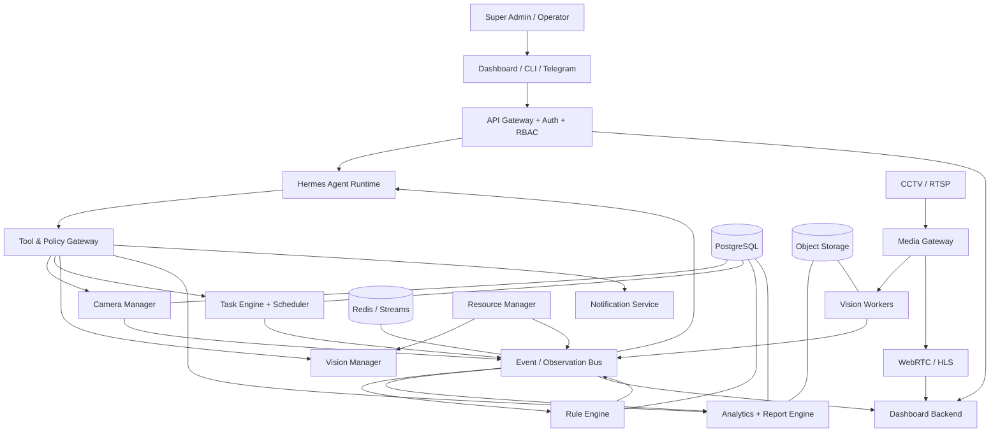
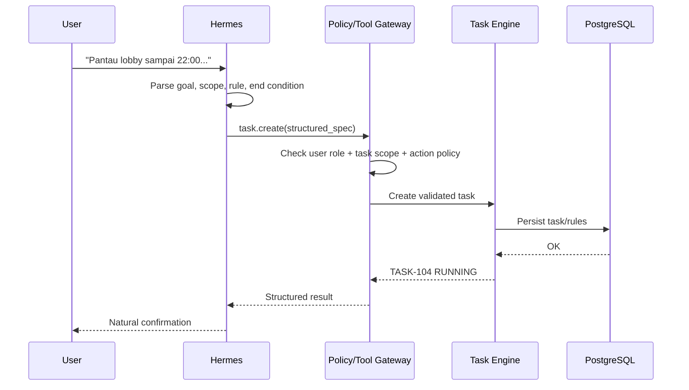
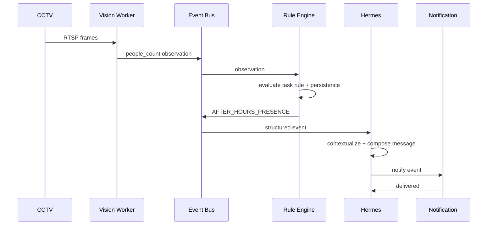

# Blueprint — Vision Agent Platform

## 1. Mission

Membangun platform computer vision yang mengubah CCTV existing menjadi sumber observation/event yang dapat dikelola sebagai task oleh Hermes. Platform harus mendukung V1 people counting tanpa fine-tuning, tetapi mempunyai extension points untuk tracking, entry/exit, anomaly learning, dan cross-camera reasoning.

## 2. Architectural North Star

## 3. Planes

### 3.1 Experience Plane
Dashboard, Telegram, dan CLI. Tidak memiliki direct access ke camera credential atau database internal.

### 3.2 Agent / Control Plane
Hermes, tool gateway, policy engine, camera manager, task engine, scheduler, rules, analytics, reporting, notifications, resource management.

### 3.3 Vision / Media Plane
RTSP ingestion, decode, frame sampling, pretrained Ultralytics inference, future tracking/ROI/line crossing.

### 3.4 Data Plane
PostgreSQL (truth), Redis (realtime), object storage (evidence/artifacts), existing NVR (continuous footage).

## 4. Request-to-Task Flow

## 5. Event-to-Report Flow

## 6. Primary Components

| Component | Responsibility | V1? |
|---|---|---:|
| API Gateway | Auth entrypoint, rate limiting, request context | Yes |
| Hermes Runtime | Language understanding, tool orchestration, natural reports | Yes |
| Tool/Policy Gateway | Typed capability boundary + authorization | Yes |
| Camera Manager | Camera registry, metadata, health | Yes |
| Media Gateway | RTSP handling + browser-compatible stream | Yes |
| Vision Worker | Ultralytics inference, frame sampling | Yes |
| Vision Manager | Worker assignment/config/profile | Yes |
| Task Engine | Persistent task lifecycle | Yes |
| Scheduler | Time-bound / recurring standing tasks | Yes |
| Rule Engine | Deterministic threshold/time/health/spike rules | Yes |
| Event Bus | Observation/event delivery | Yes |
| Analytics Engine | Aggregates, baseline, daily/task summary | Yes |
| Report Engine | Structured report artifacts | Yes |
| Notification Service | Dashboard/Telegram delivery | Yes |
| Resource Manager | GPU/worker health and adaptive allocation | Minimal V1, richer later |
| Memory Provider | Cognitive memory abstraction | Interface V1; richer provider later |
| Object Storage | snapshot/clip/report file storage | Recommended |
| Audit Service | action/tool/security trace | Yes |

## 7. Source-of-Truth Rules

- Camera/task/rule/event/permission state: **PostgreSQL**.
- Latest ephemeral state/event delivery/cache: **Redis**.
- Snapshot/event clip/report file: **Object Storage**.
- Full raw video: **existing NVR by default**.
- Agent memory: context/lesson/preferences only; never authoritative operational state.

## 8. Failure Isolation

- Vision Worker crash → task may enter DEGRADED; API/Hermes remain online.
- Hermes/LLM unavailable → existing deterministic tasks continue running.
- Redis transient issue → recover/replay/persist critical state through DB strategy.
- Camera disconnect → health event + retry; task remains explicit about lost coverage.
- Notification failure → event stays auditable and delivery can be retried.

## 9. Extension Points

### Vision adapters
`VisionModelAdapter.detect(frame) -> UnifiedDetection`

### Analytics detectors
`AnomalyDetector.evaluate(observation, context) -> EventCandidate[]`

### Memory adapters
`MemoryProvider.recall()/remember()/update()/forget()`

### Notification adapters
`NotificationProvider.send(channel, payload)`

### Media adapters
Different RTSP/media server implementations must expose stable internal interfaces.

## 10. V1 Definition of Done

Sistem dianggap memenuhi blueprint V1 ketika:

- camera stream dapat di-register tanpa credential di frontend;
- people count berjalan stabil menggunakan pretrained model;
- task natural-language dapat berubah menjadi structured persistent task;
- task tetap berjalan tanpa LLM aktif terus-menerus;
- threshold, after-hours, simple spike, dan camera health event dapat dibuat;
- event dapat dikirim ke dashboard/Telegram;
- Hermes menghasilkan confirmation, alert, resolution, dan summary yang natural;
- semua action sensitif melewati policy/RBAC;
- state dan audit dapat dipulihkan setelah restart;
- arsitektur dapat menambah tracking/ROI/entry-exit tanpa mengganti Task/Event contracts.
